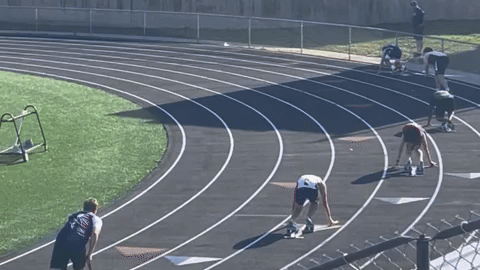

<p align="center">
  
</p>

<h3 align="center"><samp>ethan pham · lane 4</samp></h3>
<p align="center"><samp>cs + ai @ iowa state · front-end at john deere · ames, ia</samp></p>

<br>

```text
HEAT SHEET  ·  CAREER RELAY, 4 × 400M
────────────────────────────────────────────────────────────
LEG  YEAR  TEAM                 ROLE                 STATUS
 1   2025  MidAmerican Energy   IT Intern            final
 2   2026  John Deere           SWE, Channel UX      running
 3   2026  UVSA-Midwest         Technology Cabinet   running
 4   2027  Workiva              SWE Intern           on deck
────────────────────────────────────────────────────────────
training: TypeScript · React · Angular · Python · Playwright
```

<h3><samp>personal records</samp></h3>
<sub><samp>pull requests count too</samp></sub>

| event | mark | |
|---|---|---|
| **[SecondHand](https://github.com/ethanpam/SecondHand)** | `1,900+ tests` | One encrypted, on-device profile fills Iowa SNAP and food-pantry forms in a click. Team of 4, Hack Away Hunger 2026. |
| **[Tuli](https://github.com/ethanpam/Tuli)** | `9 features` | Discord bot for an ISU community: points, levels, trivia, scam protection, Gemini chat. |
| **[gemini-workflow-reviewer](https://github.com/ethanpam/gemini-workflow-reviewer)** | `3 → 1 API calls` | Gemini PR reviews posted as one-click suggestions, all in one request per PR. |

<p align="center">
  <samp>─────── finish ───────</samp><br>
  <samp><a href="https://linkedin.com/in/ethanpam">linkedin</a> · <a href="mailto:ethanpham652@gmail.com">email</a></samp>
</p>
